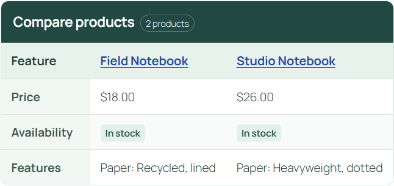

# Product Comparison Block

**What to try.** Choose published products in the block editor and verify that the storefront reads current prices and inventory.

A comparison page should show current prices and stock after merchants edit their catalogue. This CodexaWP Gutenberg block renders up to three visible WooCommerce products from live catalogue data on each request.

## Storefront preview

  
   
  <em>Storefront block · current price, availability and features side by side</em>

## Try it

Activate on a test shop and add **Product Comparison** in the editor. Use the labeled search controls to choose two or three published catalogue products by name. Existing block selections retain their product IDs. Publish a test page to see the semantic table, including a named scroll region on narrow screens.

## Verification

Activate this plugin on a disposable WordPress site with WooCommerce active and `WP_ENVIRONMENT_TYPE` set to `local`. Set `CODEXAWP_TEST_WP_LOAD` to the absolute path to that site's `wp-load.php`, then run `php tests/check.php` from this repository.

The PHP fixture checks semantic table headers, current prices after product edits and a graceful fallback when fewer than two products remain available. The editor search uses the WooCommerce Products Store API. The saved block renders server-side from its product IDs.

## License

GPL-2.0-or-later. See [LICENSE](LICENSE).
